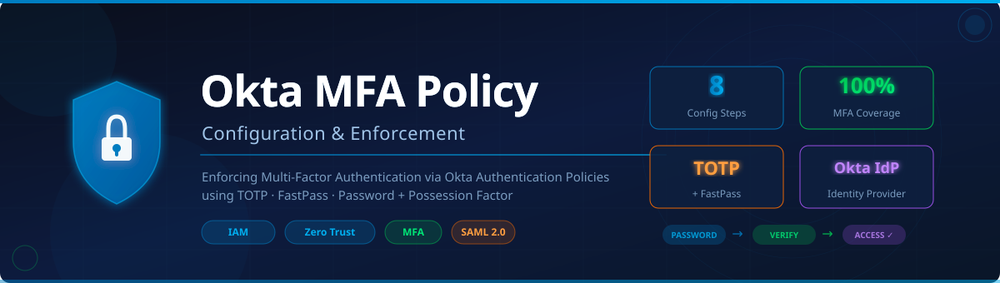
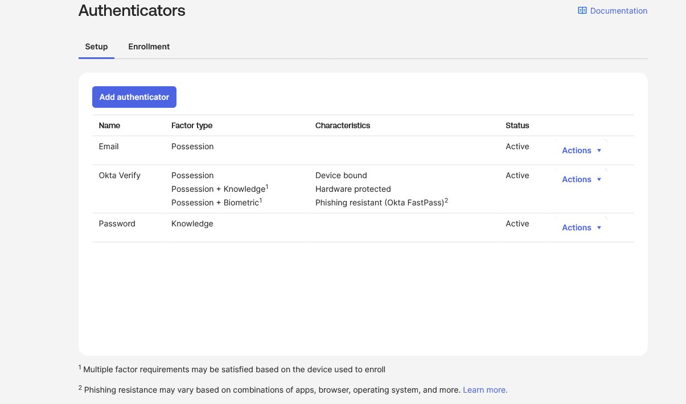
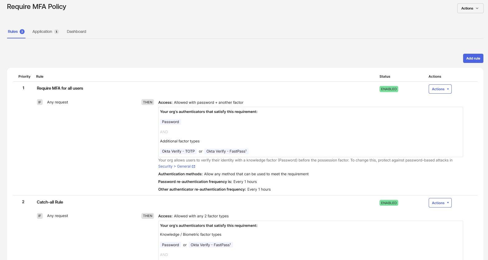
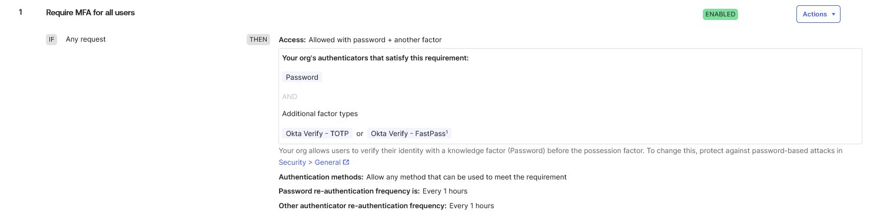
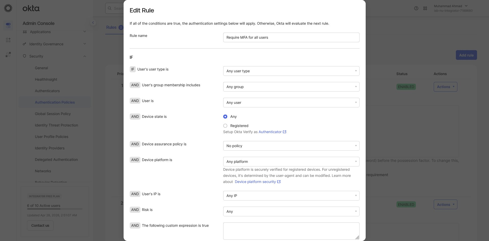
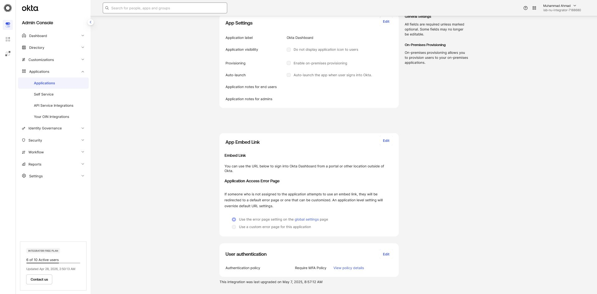
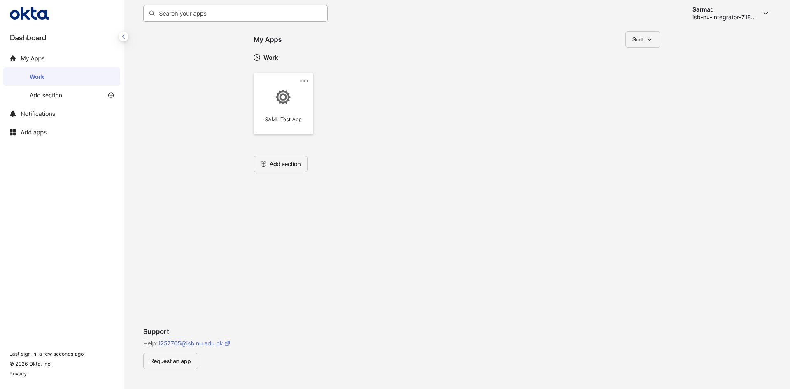
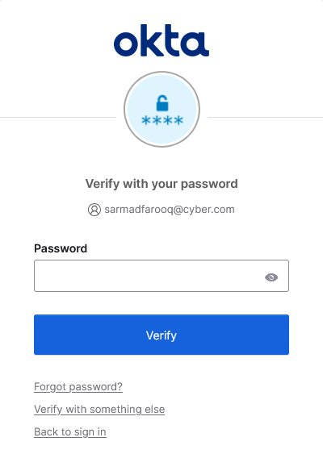
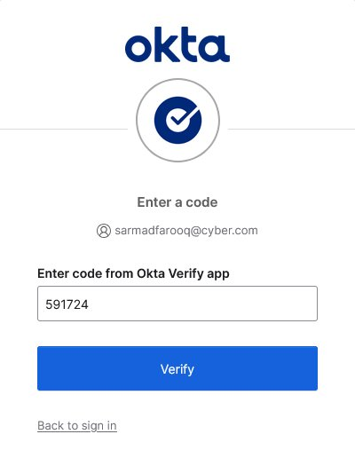

<div align="center">

<!-- BANNER -->


<br/>


<h1>🔐 Okta MFA Policy Configuration</h1>
<h3><em>Enforcing Multi-Factor Authentication across all users using Okta's Authentication Policies</em></h3>

<br/>

</div>

---

## 📋 Table of Contents

- [Overview](#-overview)
- [Objectives](#-objectives)
- [Tech Stack](#-tech-stack)
- [Architecture & Flow](#-architecture--flow)
- [Step-by-Step Configuration](#-step-by-step-configuration)
  - [Step 1 — Authenticator Setup](#step-1--authenticator-setup)
  - [Step 2 — Create MFA Authentication Policy](#step-2--create-mfa-authentication-policy)
  - [Step 3 — Configure Authentication Policies](#step-3--configure-authentication-policies)
  - [Step 4 — Edit Policy Rule (Require MFA for All Users)](#step-4--edit-policy-rule-require-mfa-for-all-users)
  - [Step 5 — Assign Policy to Application](#step-5--assign-policy-to-application)
  - [Step 6 — User Login Experience](#step-6--user-login-experience)
  - [Step 7 — Password Verification Prompt](#step-7--password-verification-prompt)
  - [Step 8 — Okta Verify TOTP Challenge](#step-8--okta-verify-totp-challenge)
- [Key Concepts](#-key-concepts)
- [Security Considerations](#-security-considerations)
- [Outcome](#-outcome)

---

## 🌐 Overview

This project demonstrates the end-to-end configuration of a **Multi-Factor Authentication (MFA) policy** inside Okta's Identity Cloud. The goal was to enforce MFA for **all users** accessing a SAML-integrated application, requiring both a password and a secondary authenticator (Okta Verify TOTP or FastPass).

This setup is representative of real-world **Zero Trust security architecture** — ensuring that no user is granted access based on a single factor alone, regardless of their network location.

---

## 🎯 Objectives

| # | Objective | Status |
|---|-----------|--------|
| 1 | Set up active authenticators (Email, Okta Verify, Password) | ✅ Done |
| 2 | Create a custom **Require MFA Policy** | ✅ Done |
| 3 | Configure a rule requiring `Password + Another Factor` for any request | ✅ Done |
| 4 | Assign the policy to the target SAML application | ✅ Done |
| 5 | Validate end-user login flow with MFA challenge | ✅ Done |

---

## 🛠 Tech Stack

| Tool | Purpose |
|------|---------|
| **Okta** | Identity Provider (IdP) |
| **Okta Verify** | TOTP & FastPass authenticator app |
| **SAML 2.0** | Application integration protocol |
| **Authentication Policies** | Okta's policy engine for access control |
| **Okta Admin Console** | Configuration interface |

---

## 🔄 Architecture & Flow

```
User Attempts Login
        │
        ▼
  Okta Evaluates Authentication Policy
        │
        ▼
  Rule: "Require MFA for all users"
  IF: Any request
  THEN: Password + Another Factor
        │
        ├──► Step 1: Password Verification  ✓
        │
        └──► Step 2: Okta Verify TOTP / FastPass  ✓
                │
                ▼
         Access Granted → User Dashboard
```

---

## 📸 Step-by-Step Configuration

### Step 1 — Authenticator Setup

> **Security → Authenticators → Setup Tab**

Three authenticators were enabled for the organization:
- **Email** — Possession factor
- **Okta Verify** — Possession + Knowledge + Biometric (Device-bound, Hardware-protected, Phishing-resistant)
- **Password** — Knowledge factor



---

### Step 2 — Create MFA Authentication Policy

> **Security → Authentication Policies → Require MFA Policy**

A dedicated policy called **"Require MFA Policy"** was created with two rules:
1. **Require MFA for all users** — `Access: Allowed with password + another factor` (Priority 1)
2. **Catch-all Rule** — Fallback for any 2-factor type (Priority 2)



---

### Step 3 — Authentication Policies Overview

> **Security → Authentication Policies**

The policy was listed and visible in the Authentication Policies dashboard.



---

### Step 4 — Edit Rule Configuration

> **Edit Rule → "Require MFA for all users"**

The rule was configured with the following conditions:

| Condition | Value |
|-----------|-------|
| User type | Any user type |
| Group membership | Any group |
| User | Any user |
| Device state | Any |
| Device assurance policy | No policy |
| Device platform | Any platform |
| User's IP | Any IP |
| Risk | Any |

**THEN** → `Access: Allowed with password + another factor`



---

### Step 5 — Assign Policy to Application

> **Applications → Okta Dashboard → User Authentication → Edit**

The **Require MFA Policy** was assigned directly to the **Okta Dashboard** application, ensuring all access attempts go through MFA enforcement.



---

### Step 6 — User Login Experience

> **End-User View — Okta Dashboard**

After authentication, the test user (`sarmadfarooq@cyber.com`) successfully reached the **Okta User Dashboard** showing the SAML Test App. This confirms the policy allowed access after MFA was satisfied.



---

### Step 7 — Password Verification Prompt

> **End-User MFA Flow — Step 1 of 2**

Upon login, the user is prompted to **verify with their password** first (knowledge factor), confirming the policy's `Password + Another Factor` requirement is active.



---

### Step 8 — Okta Verify TOTP Challenge

> **End-User MFA Flow — Step 2 of 2**

After the password, the user is challenged with a **6-digit TOTP code** from the **Okta Verify** app (possession factor). Entry of the correct code grants access.



---

## 💡 Key Concepts

| Concept | Explanation |
|---------|-------------|
| **Authentication Policy** | Okta's rule-based engine that defines access conditions per application |
| **Authenticator** | A method used to verify identity (Password, Okta Verify, Email OTP) |
| **TOTP** | Time-based One-Time Password — a rotating 6-digit code valid for ~30 seconds |
| **Possession Factor** | Something the user *has* (phone with Okta Verify) |
| **Knowledge Factor** | Something the user *knows* (password) |
| **FastPass** | Okta's phishing-resistant, passwordless authenticator |
| **Catch-all Rule** | A fallback policy rule applied when no higher-priority rule matches |

---

## 🔒 Security Considerations

- 🛡️ **Phishing Resistance** — Okta Verify with FastPass provides hardware-backed, phishing-resistant authentication
- 🔁 **Re-authentication Frequency** — Both password and other authenticators are set to re-verify every **1 hour**
- 🌐 **Zero Trust Alignment** — No user is trusted by location; all must satisfy MFA regardless of IP
- ⚠️ **Catch-all Rule** — Ensures no user can bypass MFA even if the primary rule fails to match
- 📱 **Device Binding** — Okta Verify binds the authenticator to the user's device, preventing token sharing

---

## ✅ Outcome

Successfully configured and validated a **Multi-Factor Authentication policy** in Okta that:

- Enforces **Password + Okta Verify (TOTP or FastPass)** for 100% of users
- Is scoped to the **SAML Test App** via Okta's Authentication Policy engine
- Follows **NIST 800-63B** guidelines for multi-factor authentication
- Demonstrates hands-on expertise in **IAM**, **Zero Trust**, and **Okta administration**

---

<div align="center">

**Built by Muhammad Ahmad** · Okta Identity & Security Project · 2026

[](https://linkedin.com)
[](https://github.com)

</div>
